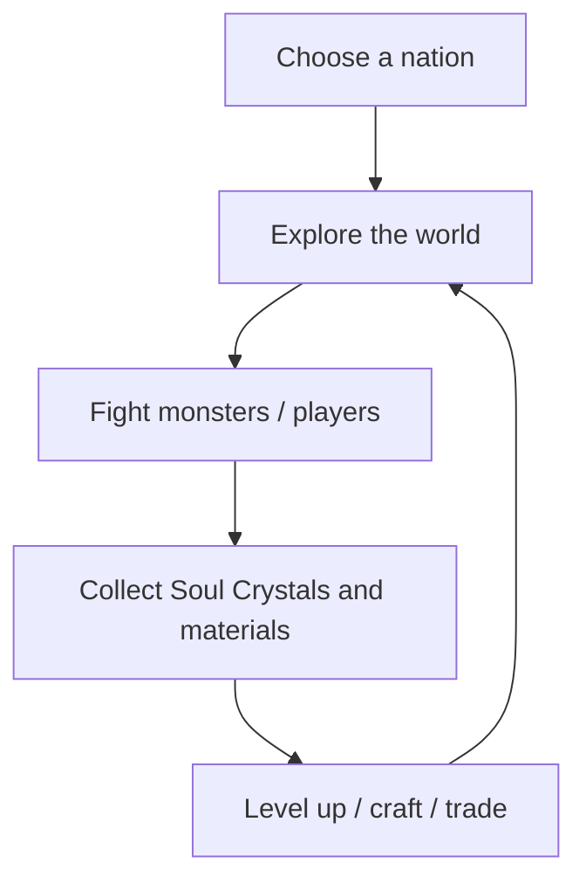

<div align="center">

# TileFantasy

**A fantasy MMO project shaped by four nations, tactical combat, and a shared resource economy.**


</div>

## Contents

- [Project vision](#project-vision)
- [Core gameplay pillars](#core-gameplay-pillars)
- [The four nations](#the-four-nations)
- [World structure](#world-structure)
- [Progression and economy](#progression-and-economy)
- [Combat and character systems](#combat-and-character-systems)
- [Conceptual game loop](#conceptual-game-loop)
- [Repository map](#repository-map)
- [Development status](#development-status)
- [Documentation](#documentation)
- [License](#license)

## Project vision

TileFantasy is a fantasy multiplayer role-playing game concept built around a shared open world, four competing nations, turn-based battles, and resource-driven progression.

Players are intended to explore regions, fight monsters and other players, develop professions, craft equipment, and compete for **Soul Crystals** — the central resource used for leveling, crafting, and exchange.

The repository contains game-design notes, world lore, visual and map directories, and separate client/server project folders. The systems below describe the design direction; they should not be interpreted as a claim that every feature is implemented.

## Core gameplay pillars

- **Nation identity:** distinct environments, classes, professions, and lore.
- **Open-world exploration:** cities, neutral areas, intermediate zones, and dungeons.
- **Turn-based combat:** tactical encounters against monsters and players.
- **Resource competition:** Soul Crystals connect progression, crafting, and trade.
- **Player specialization:** attributes, equipment, professions, and crafting.
- **World events:** a planned global-boss encounter shared by the nations.

## The four nations

| Nation | Biome | Combat identity | Profession |
|---|---|---|---|
| Steel Nation | Mountains, valleys, and lakes | Sword warrior | Blacksmith |
| Arcane Nation | Floating islands | Elemental mage | Alchemist |
| Wall Nation | Great icy wall | Bow ranger | Craftsman |
| Soul Nation | Mysterious forests | Creature tamer | Enchanter |

A personality test is intended to determine the player's starting nation. The design also describes a nation-change mechanic after five deaths.

## World structure

- **Cities:** profession houses, training, markets, throne chambers, museums, libraries, and guilds.
- **Neutral zone:** a PvP-disabled area intended for trade between nations.
- **Intermediate zones:** AI-managed regions where monsters and resource drops can change over time.
- **Primordial Portal:** the planned location for a weekly global-boss event.

## Progression and economy

Soul Crystals are designed to support:

- Character leveling
- Crafting and profession development
- Player-to-player exchange
- Creature healing, capture, and enhancement in the Soul Nation

The character design includes Strength, Dexterity, Intellect, Vitality, and Soul, with derived combat statistics such as health, energy, physical and magical defense, critical chance, accuracy, and skill mastery.

## Combat and character systems

The design documents describe nation-specific skills, weapons, armor, rings, professions, and companion creatures. PvP is intended to be available outside protected city areas, while the neutral zone is protected.

## Conceptual game loop



This is a high-level gameplay concept, not a verified runtime sequence.

## Repository map

```text
TileFantasy/
├── art/                 # Visual assets
├── game_doc             # Gameplay systems and mechanics
├── lore                 # Nation and world background
├── map/                 # Map-related content
├── tile_fantasy_server/ # Server-side project
├── tilesfantasy/        # Client/game project
└── todo                 # Development roadmap
```

## Development status

The repository combines design documentation, lore, assets, and client/server project directories. Treat the MMO features as planned or in development until their implementation is confirmed in the relevant project folders.

## Documentation

- [Game design](game_doc)
- [World lore](lore)
- [Development backlog](todo)

## License

No `LICENSE` file is currently included. Unless a license is added, reuse and redistribution permissions are not granted by this repository.
